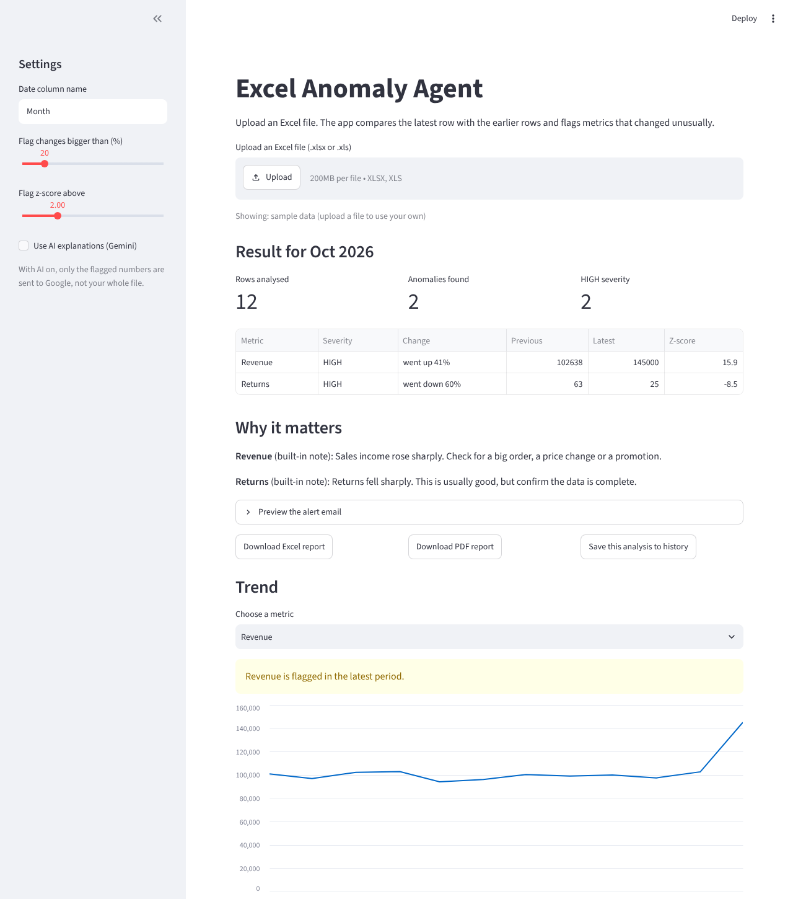

# Excel Anomaly Agent
**Live demo:** https://excelanomalyagent.streamlit.app/

Reads an Excel sheet, flags metrics that jumped or dropped unusually, explains why it matters, and emails an alert **only when something is wrong**.



## What it does

- Compares the latest row with the earlier rows (percent change + z-score).
- Rates each anomaly HIGH / MEDIUM / LOW.
- Adds a plain-English business note (built-in rules, or optional Gemini AI).
- Sends one alert email (dry-run by default). Never repeats an alert already sent.
- Streamlit dashboard, SQLite history, Excel and PDF reports.

## Quick start (Windows, PowerShell)

```powershell
python -m venv venv
.\venv\Scripts\Activate.ps1
python -m pip install -r requirements.txt
python make_sample_data.py
python main.py
python -m streamlit run app.py
python -m pytest
```

## Settings (`.env`, copy from `.env.example`)

| Name | Meaning |
|---|---|
| EMAIL_SENDER / EMAIL_PASSWORD / EMAIL_RECEIVER | Gmail address and **app password** |
| DRY_RUN | `true` = print the email, do not send |
| GEMINI_API_KEY | optional, turns on AI explanations |
| GEMINI_MODEL | optional, default `gemini-3.5-flash-lite` |
| PUBLIC_DEMO | `true` = hides AI, history and saving (for a public website) |

`.env` is in `.gitignore`. Never commit it.

## How detection works

1. Percent change of the latest value vs the previous row (flag if above 20%).
2. Z-score of the latest value vs earlier history (flag if above 2.0).
3. Severity: HIGH if |z| >= 3 or |change| >= 50%; MEDIUM if |z| >= 2 or |change| >= 30%; else LOW.

## Project layout

```
main.py                command-line run
app.py                 Streamlit dashboard
make_sample_data.py    creates data/sample_sales.xlsx
anomaly_agent/         validator, loader, detector, report, emailer,
                       history, exporter, ai_explainer, pdf_report
tests/                 47 pytest tests
docs/design.md         design document
```

## Privacy

With AI on, only the flagged numbers (metric name, previous, latest, change) go to Google. The whole file never does. If the AI fails, built-in sentences are used.

## Limits

- Compares only the latest row; it is not a forecasting model.
- Needs at least 4 rows and 3 earlier values per metric.
- On Streamlit Cloud the history database is temporary.
- The real Gemini call was not tested with a live key by the author at the time of writing.
